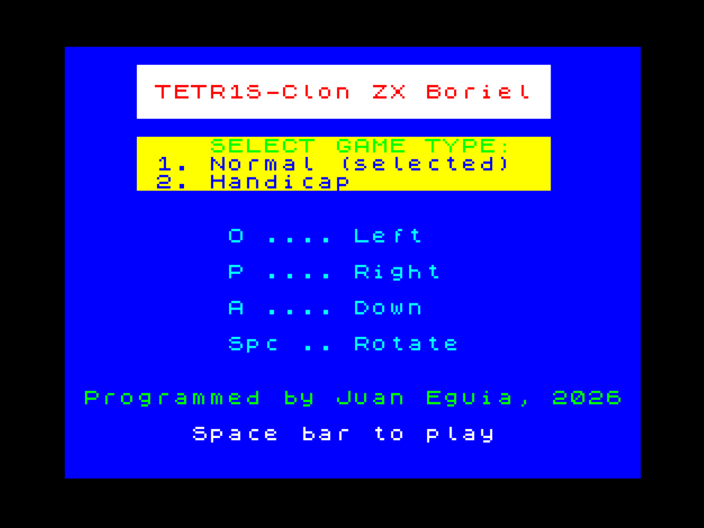
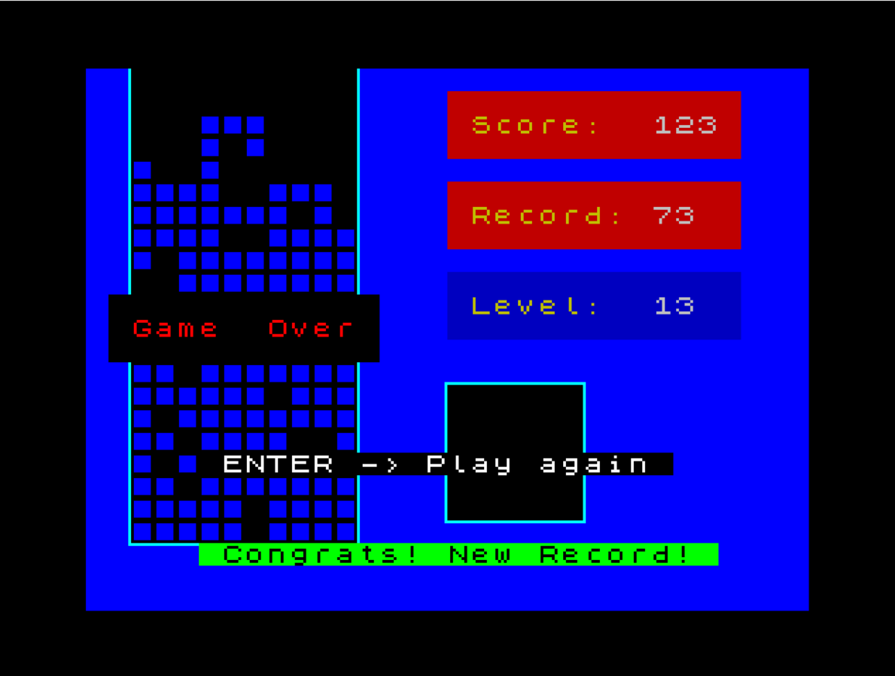
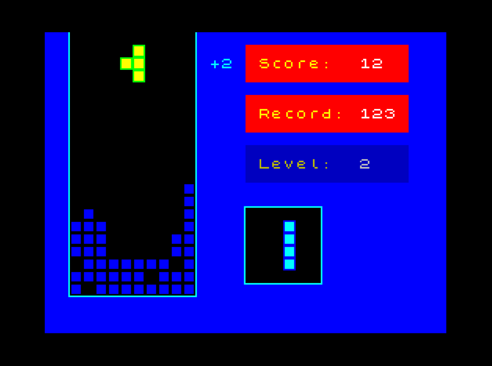

# TETR1S-Clon ZX Boriel

Clon del clásico **Tetris** para el **ZX Spectrum 48K**, programado en **Boriel ZX Basic** por Juan Eguia (2026).

<br>





## El juego

Las piezas (los 7 tetrominós clásicos: I, O, T, S, Z, L y J) caen desde la parte superior de un tablero de **10 columnas × 21 filas**. Tienes que moverlas y girarlas para encajarlas y completar líneas horizontales. Cada línea completa desaparece y las filas de encima bajan.

La partida termina cuando las piezas se apilan hasta arriba y ya no cabe una nueva.

### Tipos de partida

En la pantalla de presentación puedes elegir:

- **1. Normal**: el tablero empieza vacío.
- **2. Handicap**: el tablero empieza con algunos bloques sueltos colocados al azar en la parte de abajo, lo que dificulta hacer las primeras líneas.

### Controles

| Tecla     | Acción                                    |
|-----------|-------------------------------------------|
| `O`       | Mover a la izquierda                      |
| `P`       | Mover a la derecha                        |
| `A`       | Bajar más rápido                          |
| `Espacio` | Girar la pieza                            |
| `ENTER`   | Terminar la partida / jugar otra vez      |

Si mantienes pulsada `O` o `P`, la pieza se mueve una casilla, espera un momento y después sigue moviéndose. Para volver a girar hay que soltar `Espacio` y pulsarlo de nuevo.

### Puntuación y niveles

- Cada línea completada suma **1 punto**.

- Si haces varias líneas a la vez, aparece un aviso parpadeante **+N** junto al tablero.

- Cada **10 líneas** se sube de nivel y las piezas caen más rápido (hay 33 niveles).

- **Arranque suave**: al empezar la partida las piezas caen más despacio, y con cada pieza colocada aceleran un poco hasta llegar a la velocidad normal del nivel.

- El **récord** se guarda mientras el programa está cargado. Si lo superas, suena una fanfarria y aparece *"Congrats! New Record!"*.

A la derecha del tablero se muestran la puntuación (*Score*), el récord (*Record*), el nivel (*Level*) y la **siguiente pieza**.

### Sonido

Melodía de Tetris al empezar, efectos al mover, girar y hacer líneas, y música de *Game Over*, todo con `BEEP`.

## Código dividido en módulos

- El programa principal, `tetris.bas`, une el resto con `#include`.

| Módulo          | Qué hace |
|-----------------|----------|
| `tetris.bas`    | **Programa principal.** Configura la pantalla, muestra el menú (Normal / Handicap), contiene el bucle del juego (sacar pieza nueva, esperar al siguiente fotograma, leer el teclado, mover la pieza) y la pantalla de *Game Over* con el récord. Al final incluye los demás módulos. |
| `datos.bas`     | **Datos del juego.** Todas las constantes (tamaño del tablero, posición inicial, ajustes de velocidad y del arranque suave), el tablero `fondo`, la definición de las 7 piezas con sus 4 rotaciones (`piezas`), sus colores, la tabla de velocidad de caída por nivel y las variables globales. Es el primer sitio donde mirar para ajustar el juego. |
| `pieza.bas`     | **La pieza que cae.** Moverla a los lados y hacia abajo, girarla, comprobar colisiones con las paredes y con los bloques, la caída automática por tiempo, borrarla y dibujarla en pantalla, y dejarla fija en el tablero al tocar fondo. |
| `tablero.bas`   | **Tablero y pantalla.** Dibuja el marco y el fondo, coloca los bloques del modo Handicap, comprueba las líneas completas y las elimina bajando las filas de encima, y muestra los marcadores (Score, Record, Level), el aviso **+N** y la siguiente pieza. |
| `controles.bas` | **Teclado.** Lee las teclas directamente de los puertos del Spectrum. Gestiona la repetición al mantener `O`/`P`, la bajada con `A` y el giro con `Espacio` (un giro por pulsación). |
| `sonido.bas`    | **Sonido.** Los efectos cortos (`sonidoAscend`) y las músicas: melodía de Tetris, *Game Over* y fanfarria de récord. |
| `graficos.bas`  | **Gráficos.** El dibujo del bloque (UDG hecho con SevenuP, en ensamblador) y la rutina que apunta los gráficos de usuario a ese dibujo. |

Los módulos no se compilan por separado: siempre se compila `tetris.bas`, que los incluye a todos.

## Cómo jugar

Carga el archivo `.tap` en cualquier emulador de ZX Spectrum (Fuse, ZEsarUX, Spectaculator, etc.) o en un Spectrum real, con `LOAD ""`.

## Cómo compilar

Hace falta el compilador [Boriel ZX Basic](https://github.com/boriel-basic/zxbasic) (`zxbc`):

```
zxbc -f tap -aB tetrisyt-fix.bas
```

- `-f tap` genera un archivo de cinta `.tap`.
- `-a` añade la línea de autoarranque.
- `-B` incluye el cargador en BASIC.

## Detalles técnicos

- El tablero se guarda en el array `fondo(20, 9)`. Cada pieza y sus 4 rotaciones se definen como desplazamientos (y, x) en el array `piezas(27, 7)`.
- Los bloques se dibujan con un gráfico definido por el usuario (UDG, `CHR$(144)`) diseñado con SevenuP.
- El teclado se lee directamente de los puertos (`IN $7FFE`, `$FDFE`, `$DFFE`) para tener una respuesta inmediata.
- El bucle principal se sincroniza con la interrupción de pantalla (`HALT`, 50 fotogramas por segundo), así que la velocidad del juego no depende de lo que tarde el código en ejecutarse.
- Las velocidades se ajustan con constantes al principio del código: `tiempo_cae_pieza_nivel`, `RALENTIZACION_INICIAL`, `PIEZAS_POR_PASO`, `LATERAL_RETARDO_INICIAL`, `LATERAL_REPETIR` y `ABAJO_REPETIR`.

## Autor

Juan Eguía - 2026

## Licencia
Este proyecto se distribuye bajo la licencia MIT. Consulta el archivo LICENSE
